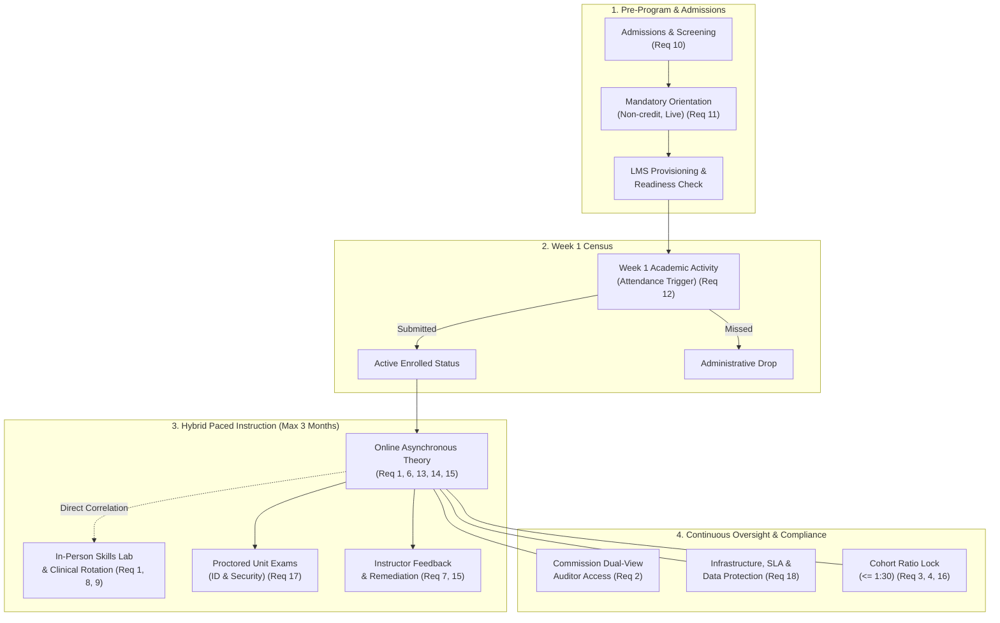
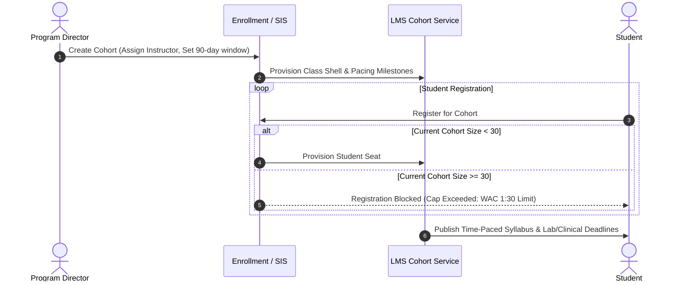
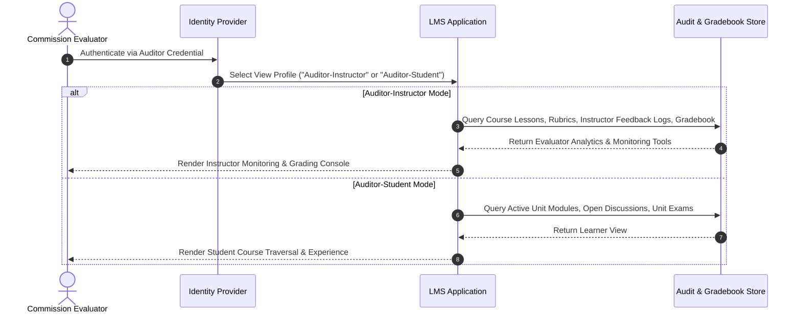
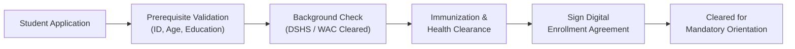
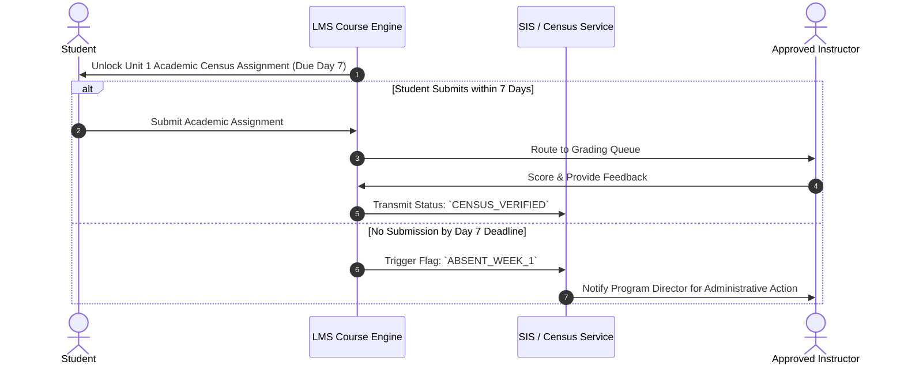
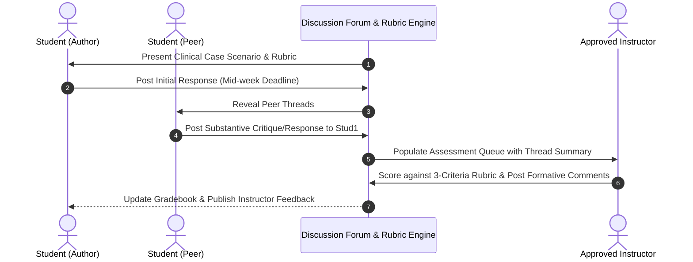
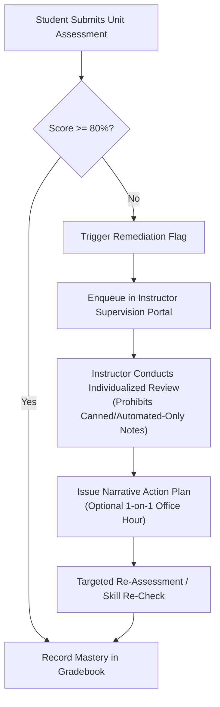

# WAC 246-841A-440 Hybrid Nursing Assistant Training Program: Functional Specification & Implementation Blueprints

This document specifies the technical, pedagogical, and administrative implementation requirements under **WAC 246-841A-440** for delivering online theory with asynchronous elements in a Washington State Nursing Assistant Training Program (NATP).

---

## 1. Regulatory Context & Architectural Overview

WAC 246-841A-440 governs the delivery of hybrid Nursing Assistant programs in Washington State. It mandates strict separation between theory (online/asynchronous) and psychomotor/clinical training (in-person), limits cohort sizes to a 1:30 instructor-student ratio, restricts program duration to a 3-month envelope, and requires rigorous authentication, feedback, and supervision mechanisms.

---

## 2. Core Functional Modules & Workflows

### Module 1: Cohort Scheduling, Ratios & Lifecycle Engine
* **WAC Items Addressed:** 1, 3, 4, 16
* **Objective:** Enforce the hybrid boundary, 1:30 instructor-to-student ceiling, 3-month completion horizon, and structured pacing milestones.

#### Functional Breakdown
1. **Hybrid Modality Boundary:** The Learning Management System (LMS) catalogs courses into strictly delineated types: Theory (`ASYNC_ONLINE`), Skills Lab (`IN_PERSON_LAB`), and Clinical (`IN_PERSON_CLINICAL`). Lab and clinical skills validation cannot be marked complete via online tasks.
2. **Hard Ratio Enforcement:** The enrollment service imposes a ceiling of 30 active student seats per assigned Primary Approved Instructor. Attempts to enroll a 31st student trigger a waitlist or require secondary approved instructor assignment.
3. **Pacing & 3-Month Timebox:** Course instances are parameterized with `start_date` and `end_date`, where $(end\_date - start\_date) \le 90 \text{ calendar days}$ (excluding designated high school 10-month tracks). Dynamic pacing bars track individual student progression against target week milestones.

#### Workflow: Cohort Lifecycle Management

---

### Module 2: State Commission Reviewer & Auditor Portal
* **WAC Items Addressed:** 2, 20
* **Objective:** Provide the Washington State Nursing Care Quality Assurance Commission transparent, simultaneous dual-role audit access into active and template course shells.

#### Functional Breakdown
1. **Dual-View Account Provisioning:** Provision two static, pre-configured commission reviewer profiles:
   * **Auditor-Instructor View:** Access to lesson authoring tools, rubric grading panes, complete electronic gradebook, student submission histories, and direct student communication logs.
   * **Auditor-Student View:** Experience identical to an enrolled student, allowing end-to-end traversal of lessons, quizzes, discussion boards, and assignment submission portals.
2. **Access Security & Audit Logging:** Auditor accounts are bound to multi-factor authentication (MFA) or secure access credentials with read-only visibility into personal identifiable student data (FERPA compliant) while displaying instructional interactions.

#### Workflow: Commission Inspection Workflow

---

### Module 3: Admissions Screening & Student Selection Funnel
* **WAC Items Addressed:** 10, 19
* **Objective:** Screen, verify, and document student entry criteria prior to cohort activation.

#### Functional Breakdown
1. **Eligibility Verification:** Automated collection and verification of state-mandated prerequisites:
   * Age verification ($\ge 16$ or 18 as per policy).
   * Government-issued photo identification.
   * Criminal background check clearance (DSHS / Washington State Patrol WATCH).
   * Health clearances (TB/2-step PPD, Hepatitis B, Influenza/COVID vaccinations as required).
2. **Enrollment Agreement Binding:** Digital execution of the formal Enrollment Agreement documenting the hybrid commitment, hardware/connectivity requirements, attendance mandates, and refund policies.

#### Workflow: Admissions & Onboarding

---

### Module 4: Mandatory Pre-Program Orientation Subsystem
* **WAC Items Addressed:** 11
* **Objective:** Conduct and document a live (synchronous online or in-person) orientation prior to course start that is tracked outside core instructional hours.

#### Functional Breakdown
1. **Attendance Tracking:** Synchronous verification via live video log-in or digital sign-in roster.
2. **Curriculum Modules:**
   * WAC 246-841A program expectations, integrity, and codes of conduct.
   * Navigation of LMS, discussion board posting, and assignment upload workflows.
   * Technical requirements, troubleshooting channels, and exam security policies.
3. **Zero-Hour Rule Enforcement:** Orientation attendance is logged under a distinct code (`ORIENTATION_NON_CREDIT`) and is explicitly excluded from the required 35+ classroom/theory hours.

---

### Module 5: Week-1 Academic Attendance Verification (Census Engine)
* **WAC Items Addressed:** 12
* **Objective:** Validate official attendance in the first week through an academic-based assignment tied to course outcomes.

#### Functional Breakdown
1. **Assignment Criteria:** A substantive academic assignment (e.g., *"Unit 1: Professional Boundaries & Nursing Assistant Scope of Practice Analysis"*), not a passive login or generic intro.
2. **Automated Census Trigger:** The LMS flags the student's record as `ATTENDANCE_CONFIRMED` upon grading or verified submission of this specific task within Days 1–7.
3. **No-Show Resolution:** Failure to complete by the Day 7 midnight deadline triggers an immediate notification to the Program Director for administrative withdrawal or intervention.

#### Workflow: Week-1 Attendance Verification

---

### Module 6: Curriculum Correlation Engine (Theory $\rightarrow$ Lab $\rightarrow$ Clinical)
* **WAC Items Addressed:** 6, 8, 19
* **Objective:** Systematically link every online lecture and reading to specific psychomotor lab skills and clinical competencies.

#### Functional Breakdown
1. **Textbook & WAC Crosswalk Table:** Every unit in the online course syllabus has a relational database mapping:
   $$\text{WAC Topic} \longleftrightarrow \text{Textbook Chapter/Page Range} \longleftrightarrow \text{Online Lesson} \longleftrightarrow \text{Lab Skill Checklist} \longleftrightarrow \text{Clinical Performance Record}$$
2. **Prerequisite Gating:** Enforce that corresponding online theory modules (e.g., Vital Signs Theory & Range Calculations) must be successfully completed ($\ge 80\%$) before the student can participate in the corresponding in-person skills lab simulation.

#### Architectural Matrix Model
| Unit # | WAC Outcome Topic | Required Text Chapter | LMS Module ID | Lab Simulation Skill | Clinical Floor Competency |
| :--- | :--- | :--- | :--- | :--- | :--- |
| **01** | Infection Control & Bloodborne Pathogens | Ch. 2, pp. 25–48 | `TH-MOD-101` | Hand Hygiene, Donning/Doffing PPE | Standard Precautions in Long-Term Care |
| **02** | Body Mechanics & Transfers | Ch. 7, pp. 112–138 | `TH-MOD-102` | Gait Belt, Mechanical Lift, Pivot Transfer | Resident Transfer Bed-to-Wheelchair |
| **03** | Vital Signs Measurement | Ch. 9, pp. 160–189 | `TH-MOD-103` | Manual BP, Radial Pulse, Resp, Temp | Patient V/S Assessment & Charting |

---

### Module 7: Asynchronous Collaborative Discussion Engine
* **WAC Items Addressed:** 13
* **Objective:** Facilitate peer-to-peer discourse and instructor interaction for every instructional unit with a standardized evaluation rubric.

#### Functional Breakdown
1. **Unit-Bound Forums:** Every instructional unit must deploy at least one mandatory discussion forum centered on a real-world clinical scenario (e.g., resident rights conflict, dementia behavioral management).
2. **Participation Architecture:**
   * Initial substantive post due midweek.
   * Minimum of two substantive, reflective peer responses due by unit end.
3. **Structured Rubric Integration:** Direct integration with an analytic grading rubric assessing:
   * Outcome Mastery & Evidence-Based Justification (40%)
   * Critical Thinking & Scenario Application (30%)
   * Professional Tone & Peer Engagement (30%)

#### Workflow: Unit Discussion Cycle

---

### Module 8: Instructor Direct Supervision & Non-Automated Feedback Engine
* **WAC Items Addressed:** 7, 9, 15
* **Objective:** Ensure continuous, meaningful supervision by an approved RN instructor, prohibiting automated-only grading for student remediation.

#### Functional Breakdown
1. **Activity Monitoring Dashboard:** Instructors have real-time tracking of student login frequency, time-on-page, video completion percentages, quiz attempts, and forum participation.
2. **Remediation Trigger Thresholds:** When an exam or assignment score falls below passing ($< 80\%$), the LMS automatically opens an *Instructor Remediation Ticket*.
3. **Human Feedback Enforcement:** The remediation mechanism mandates personalized, narrative feedback written directly by the instructor (minimum character threshold, individualized notes, or booked 1-on-1 video office hour session). Computer-generated automated feedback statements do not satisfy remediation clearance.

#### Workflow: Remediation & Direct Feedback Loop

---

### Module 9: Independent Peer Study Group Subsystem
* **WAC Items Addressed:** 14
* **Objective:** Enable students to organize, meet, and collaborate independently outside of scheduled classroom hours.

#### Functional Breakdown
1. **Self-Service Study Rooms:** Student dashboard feature allowing learners to generate virtual study rooms (embedded WebRTC, Zoom, or Teams links) without requiring instructor hosting.
2. **Peer Interaction Tools:** Integrated shared whiteboards, document co-authoring for skills prep, and peer messaging channels.
3. **Participation Tracking:** Logs meeting occurrences and durations for internal program analytics while maintaining student autonomy.

---

### Module 10: Examination Security & Identity Verification Subsystem
* **WAC Items Addressed:** 17
* **Objective:** Guarantee identity validation and prevent cheating during online unit tests and comprehensive theoretical examinations.

#### Functional Breakdown
1. **Pre-Exam Verification:**
   * Student photo ID capture against enrollment baseline records.
   * 360-degree environmental scan via webcam.
2. **Lockdown & Proctoring Environment:**
   * Browser lockdown preventing external tabs, virtual machines, dual monitors, copy-pasting, or screen recording.
   * Automated anomaly detection (secondary face detection, absent face, audio spikes) paired with live or recorded human instructor review.
3. **Randomized Question Banks:** Algorithmically pull questions from tagged question banks to present varied item orders and distractors per learner.

#### Workflow: Secure Online Examination

```mermaid
sequenceDiagram
    autonumber
    actor Stud as Student
    participant Lock as Lockdown Client
    participant Auth as Identity & Biometric Verification
    participant LMS as Exam Engine
    actor Inst as Instructor / Reviewer

    Stud->>Lock: Launch Secure Testing Browser
    Lock->>Auth: Scan Gov Photo ID & Perform Facial Match
    Auth-->>Lock: Identity Verified
    Lock->>Stud: Prompt 360-degree Room Scan
    Lock->>LMS: Unlock Proctored Exam Instance
    loop During Examination
        Lock->>Lock: Monitor Gaze, Audio, Dual Monitors, Tab Switching
    end
    Stud->>LMS: Submit Completed Exam
    Lock->>Inst: Flag Anomalies (Audio, Extra Faces) for Human Verification
    Inst-->>LMS: Certify Exam Integrity & Release Score
```

---

### Module 11: Technical Support, Infrastructure & Data Security
* **WAC Items Addressed:** 18
* **Objective:** Guarantee platform availability, data durability, FERPA compliance, and dedicated technical helpdesk services.

#### Functional Breakdown
1. **High Availability & Redundancy:**
   * Cloud-hosted infrastructure with a minimum Service Level Agreement (SLA) of 99.9% uptime.
   * Automated daily snapshots and geo-redundant backups of student progress, submission timestamps, and gradebook states.
2. **Information Security:**
   * End-to-end TLS 1.3 encryption in transit and AES-256 encryption at rest.
   * Strict Role-Based Access Control (RBAC) ensuring FERPA privacy compliance.
3. **Student Technical Support Services:**
   * Tier-1 multi-channel support (Email, Live Chat, Phone) with guaranteed maximum 4-hour response during operational hours.
   * Self-help knowledgebase: Browser setup, lockdown configuration, mobile app guidance, and troubleshooting FAQs.

---

### Module 12: Comprehensive Program Application & Documentation Assembly
* **WAC Items Addressed:** 5, 20
* **Objective:** Compile all organizational narrative responses, evidence documents, and credentials into a single unified submission package for the Commission.

#### Functional Breakdown
* **Package Indexing:** Structured compilation of all required documentation into a hyperlinked master document containing:
  1. **Section 1: Organizational Readiness:** History of online success, institutional accreditations, or Quality Matters (QM) certifications (Req 5).
  2. **Section 2: Curriculum Master Plan:** Paced schedule (Req 4, 16), Curriculum-Textbook-Lab crosswalk (Req 6, 8, 19).
  3. **Section 3: Academic Policies:** Enrollment criteria (Req 10), Orientation agenda (Req 11), Week-1 attendance protocol (Req 12), Discussion rubrics (Req 13), Study group procedures (Req 14), Remediation SOP (Req 15).
  4. **Section 4: Technical & Security Plans:** Exam integrity protocols (Req 17), LMS architecture, reliability, backup SLA, and support policies (Req 18).
  5. **Section 5: Evaluator Access Dossier:** Direct URLs and pre-configured test credentials for student and instructor views (Req 2).

---

## 3. Verification & Compliance Checklist

| Item # | WAC 246-841A-440 Requirement | Implementation Artifact | Responsible Party |
| :---: | :--- | :--- | :--- |
| **01** | Theory online only; in-person lab & clinical | Master Syllabus & Course Modality Policy | Program Director |
| **02** | Dual commission LMS access (student + instructor) | Reviewer Credential Sheet & Access Guide | LMS Administrator |
| **03** | Max 1:30 instructor-to-student ratio | SIS Enrollment Cap Rules & Roster Reports | Registrar / PD |
| **04** | Completion within 3 months | 12-Week Academic Calendar & Cohort Pacing Map | Lead Instructor |
| **05** | Evidence of online training capability/success | Institutional History, QM Review, or Certs | Executive Leadership |
| **06** | Text reading & curriculum correlation | Textbook Crosswalk Matrix | Lead Instructor |
| **07** | Instructor interaction & support throughout | Faculty Communication Policy & Contact Logs | Approved Instructors |
| **08** | Close correlation of theory, lab, and clinical | Integrated Curriculum Alignment Framework | Curriculum Committee |
| **09** | Direct supervision by approved instructor | Approved RN Instructor Designations & Rosters | Program Director |
| **10** | Student selection & entry requirements | Admissions Handbook & Candidate Scorecard | Admissions Office |
| **11** | Mandatory live pre-program orientation | Orientation Deck, Agenda, & Attendance SOP | Student Services |
| **12** | Week 1 academic attendance assignment | Graded Unit 1 Assignment Blueprint & Census SOP | Lead Instructor |
| **13** | Unit discussion + peer engagement + rubric | Discussion Prompt Library & 3-Tier Rubric | Instructional Designer |
| **14** | Independent study group facilitation | LMS Collaborative Virtual Room Integration | Tech Support / LMS Admin |
| **15** | Robust, individualized, non-automated feedback | Faculty Remediation Guidelines & Audit Log | Approved Instructors |
| **16** | Paced schedule with clear deadlines | Student Pacing Guide & Deadline Schedule | Lead Instructor |
| **17** | Online exam identity verification & security | Proctoring Configuration SOP & Exam Policy | IT & Lead Instructor |
| **18** | Technical support, reliability, backup, privacy | IT Disaster Recovery Plan & Helpdesk SLA | Systems Engineer |
| **19** | Full compliance with NA training chapter rules | Master WAC 246-841A Regulatory Audit Binder | Compliance Officer |
| **20** | Unified single-package email submission | Hyperlinked Master PDF Application Binder | Program Director |
