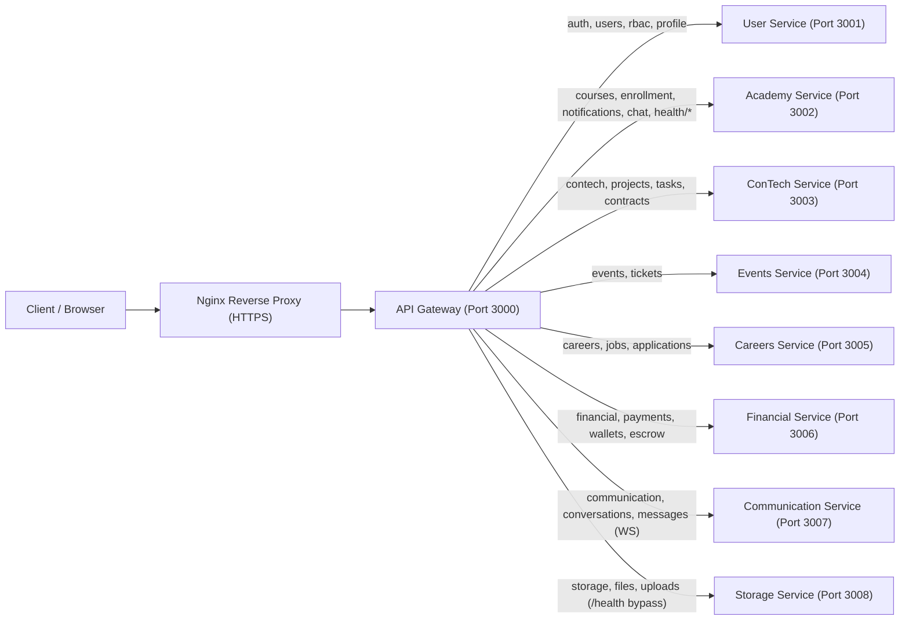
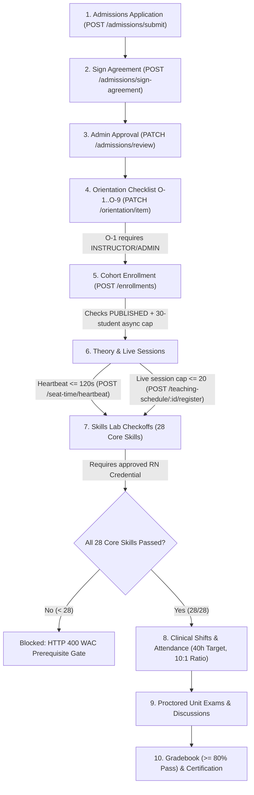
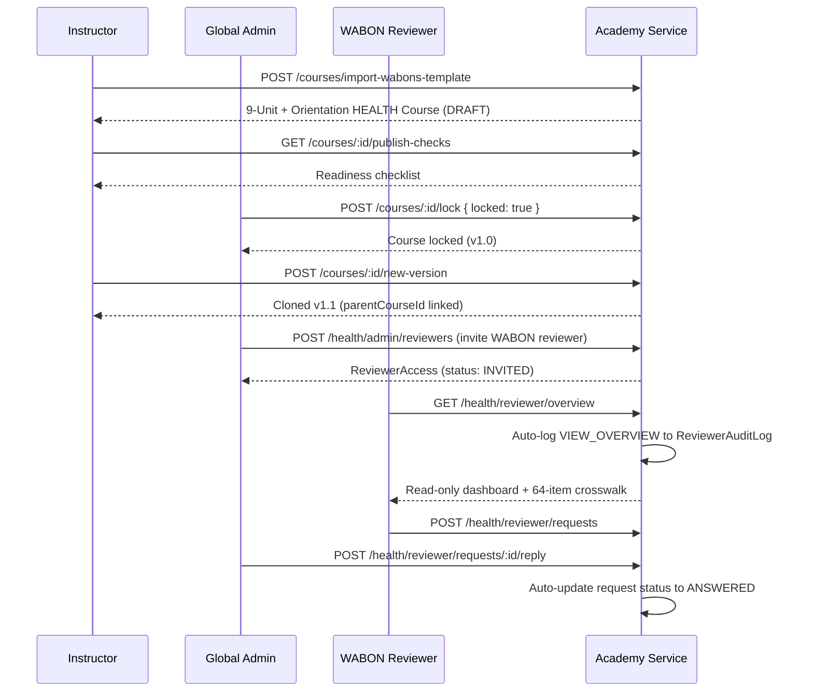

# AlikoHub Academy & Health Compliance — Changes, Architecture & Flows

This document details all recent backend, API Gateway, Prisma schema, and compliance changes across `main` (`07f15a8` through `8baf001`), along with end-to-end system flows, Mermaid diagrams, RBAC rules, API payloads, and verification results.

---

## 1. Commit Timeline

| Commit | Scope | Summary |
|---|---|---|
| `07f15a8` | Gateway / User / Academy | Restore auth proxies, `login-google` route, Joi validation pipe, and rubric DTO validation |
| `7e1f869` | Deploy | Preserve local production hotfixes during deployment pull |
| `7374101` | User Service | Handle numeric & string application IDs, add auth route aliases, and improve TCP pipe validation |
| `fb31b14` | Auth | Auto-sync database users into Firebase Auth on login when missing |
| `6035176` | Storage / Scripts | Bypass health check in `fileAuthMiddleware` and fix DB URL in `seed_core_skills.ts` |
| `177626e` | API Gateway | Remove plain-path globs (`'/api/v1/chat'`, `'/chat'`) causing `ERR_CONTEXT_MATCHER_INVALID_ARRAY` and route `/notifications/**` to `academy-service` |
| `29ac573` | Academy / Health | Separate `GENERAL` vs `HEALTH` courses (`CourseDomain`), implement Health FR-01..FR-10 |
| `52d37e7` | Health Schedule | Implement S9 cohort pacing & scheduling business logic |
| `fc4522a` | API Gateway | Proxy prefixed & unprefixed `/health/student/**`, `/health/grades/**`, `/health/schedule/**`, `/health/instructor/**`, `/health/admin/**`, `/health/reviewer/**` routes |
| `ab95c74` | Instructor (Doc 6) | Implement I1–I11 APIs: WABON 9-unit template import, publish readiness checks, course lock & versioning, live cap `20`, unified grading queue |
| `bd3d507` | Admin (Doc 7) | Implement A1–A10 Global Admin APIs: approvals, program documents, facilities, reviewer invites & audit logs, WAC 490-105 refunds, content library, analytics |
| `396ed80` | Reviewer (Doc 8) | Implement W1–W12 WABON Reviewer portal: read-only oversight, student name masking, 64-item crosswalk, evidence locker export, reviewer requests & auto-audit logging |
| `3bc95aa` | Docs | Add Final Student, Instructor, Global Admin, and WABON Reviewer specifications (`docs/5..8`) |
| `8baf001` | Health Dashboard | Query `prisma.coreSkill.count()` (`28`) for `hoursProgress.lab.totalSkills` instead of hardcoding `22` |

---

## 2. API Gateway & Microservice Routing Flow

In [apps/api-gateway/src/main.ts](file:///root/Home-Project/apps/api-gateway/src/main.ts), `http-proxy-middleware` v3 requires all entries in `pathFilter` to be uniform globs (mixing plain strings like `'/chat'` with globs like `'/chat/**'` throws `ERR_CONTEXT_MATCHER_INVALID_ARRAY` and causes routes to fall through to 404). All 8 proxy filters now use uniform `/**` globs.

Additionally, LMS REST notifications (`/api/v1/notifications/**`, `/notifications/**`) were moved from `communication-service` (port `3007`, which only hosts WebSockets) to `academy-service` (port `3002`), and all 6 new Health portal prefixes were wired with unprefixed rewrites.

### Gateway Rewrite Rules Added
| Incoming Unprefixed Path | Rewritten Target Path | Target Service |
|---|---|---|
| `/notifications/**` | `/api/v1/notifications/**` | `academy-service` |
| `/health/student/**` | `/api/v1/health/student/**` | `academy-service` |
| `/health/grades/**` | `/api/v1/health/grades/**` | `academy-service` |
| `/health/schedule/**` | `/api/v1/health/schedule/**` | `academy-service` |
| `/health/instructor/**` | `/api/v1/health/instructor/**` | `academy-service` |
| `/health/admin/**` | `/api/v1/health/admin/**` | `academy-service` |
| `/health/reviewer/**` | `/api/v1/health/reviewer/**` | `academy-service` |

---

## 3. End-to-End Health Program Student Lifecycle & Compliance Gates

Washington State (WABON / WAC 246-841A-440) compliance rules are enforced directly in the service layer across Admissions, Orientation, Enrollments, Seat Time, Skills Lab, Clinical, and Exam Security.

### Key Business Rules Enforced
1. **Course Domain Separation (`GENERAL` vs `HEALTH`)**:
   - `GENERAL` courses bypass WABON publish checks (`canPublish: true`).
   - `HEALTH` courses enforce unit/hour/quiz readiness checks via `GET /api/v1/courses/:id/publish-checks`.
2. **RN Credential Gate (Skills Lab & Clinical)**:
   - Instructors without a `InstructorCredential` record approved by Director/DOH receive `403 Forbidden` when attempting to sign off skills (`POST /skills-lab/checkoffs`) or create clinical shifts (`POST /clinical/shifts`).
3. **28-Skill WAC Clinical Prerequisite Gate**:
   - `POST /clinical/attendance` checks that the student has passed all `28` `CoreSkill` items; otherwise returns `400 Bad Request` with the remaining skill count.
4. **Seat-Time Heartbeat Cap**:
   - `POST /seat-time/heartbeat` enforces `activeSeconds <= 120` per heartbeat (returns `400` if exceeded).
5. **Enrollment & Ownership Gating**:
   - `PATCH /exercises/:id/autosave` returns `403` if the student is not enrolled in the course.
   - `GET /health/grades/unit-summary/:userId` returns `403` if a student requests another student's grade summary.
   - `PATCH /orientation/item` returns `403` if a student attempts to mark instructor-only item `O-1`.

---

## 4. Course Lifecycle, Global Admin & WABON Reviewer Flows

### Workforce Board Refund Schedule (WAC 490-105)
`POST /api/v1/health/admin/refunds` automatically calculates `calculatedRefundAmount` and `agreementRuleApplied` based on `progressPercent`:

| Completion (`progressPercent`) | Refund Percentage | Applied Rule |
|---|---|---|
| `<= 0%` | `100%` | Before instruction begins (WAC 490-105) |
| `<= 10%` | `90%` | `<= 10%` program completed |
| `<= 25%` | `75%` | `11%–25%` program completed |
| `<= 50%` | `50%` | `26%–50%` program completed |
| `> 50%` | `0%` | `> 50%` program completed per signed agreement |

---

## 5. Database Schema Additions ([schema.prisma](file:///root/Home-Project/apps/academy-service/prisma/schema.prisma))

### New Models
- `LiveSessionRegistration` — tracks student registrations, attendance (`attended`, `joinedAt`, `leftAt`), and instructor confirmation for `TeachingSchedule` live sessions (capped at 20).
- `RegulatoryApproval` — tracks agency (`WABON`, `WORKFORCE_BOARD`, `CREDENTIA`) approval milestones, statute references, and statuses (`PLANNED`, `SUBMITTED`, `IN_REVIEW`, `APPROVED`, `ACTION_REQUIRED`).
- `ProgramDocument` — stores application packages and compliance documents shared with reviewers.
- `ReviewerAccess` & `ReviewerAuditLog` — manages time-limited reviewer invitations, optional student-name masking (`maskStudentNames`), and automatic read-only access audit trails.
- `RefundRequest` — stores withdrawal dates, progress snapshots, tuition paid, WAC 490-105 calculated refunds, and admin review status.
- `ClinicalFacility` — tracks clinical sites, agreements, expiration dates, and maximum instructor-to-student ratio (`<= 10`).
- `ReviewerRequest` & `ReviewerRequestReply` — threaded Q&A between WABON reviewers and program admins/instructors.

### Extended Models
- `Course`: added `CourseDomain` (`GENERAL` | `HEALTH`), `regulatoryBody`, `complianceProfile`, `version`, `isLocked`, `parentCourseId`.
- `Module`: added `unitNumber`, `scheduledOpenDate`, `targetTheoryHours`, `targetLabHours`, `studentGuidePages`, `characters`.
- `Lesson`: added `hourType`, `countsTowardSeatTime`, `mappedCompetency`, `crosswalkRow`.
- `Content`: added `durationSeconds`, `isDownloadable`, `visibility`, `transcript`.
- `CoreSkill`: added `taughtInUnit`, `demoVideoUrl`.
- `ClinicalShift`: added `groupName`, `maxStudents` (default `10`).
- `InstructorCredential`: added `roleTitle`, `dohVerifiedAt`, `dohVerificationNotes`.
- `DiscussionTopic`: added `postFirst`, `minReplies`.

---

## 6. New & Updated Modules Summary

| Module | Controller / Service | Auth & Roles |
|---|---|---|
| **Health Dashboard** | [health-dashboard.controller.ts](file:///root/Home-Project/apps/academy-service/src/health-dashboard/health-dashboard.controller.ts) [health-dashboard.service.ts](file:///root/Home-Project/apps/academy-service/src/health-dashboard/health-dashboard.service.ts) | `AcademyProfileGuard`; student dashboard (owner), unit summary (owner or staff), schedule (enrolled or staff), instructor console/audit (`INSTRUCTOR`, `ADMIN`, `COURSE_MANAGER`, `COMMISSION_AUDITOR`), grading queue (`INSTRUCTOR`, `ADMIN`, `COURSE_MANAGER`) |
| **Health Admin** | [health-admin.controller.ts](file:///root/Home-Project/apps/academy-service/src/health-admin/health-admin.controller.ts) [health-admin.service.ts](file:///root/Home-Project/apps/academy-service/src/health-admin/health-admin.service.ts) | `AcademyProfileGuard`; `GET` allows `ADMIN`, `COURSE_MANAGER`, `COMMISSION_AUDITOR`; mutations require `ADMIN` (except student `POST /refunds`) |
| **Health Reviewer** | [health-reviewer.controller.ts](file:///root/Home-Project/apps/academy-service/src/health-reviewer/health-reviewer.controller.ts) [health-reviewer.service.ts](file:///root/Home-Project/apps/academy-service/src/health-reviewer/health-reviewer.service.ts) | `AcademyProfileGuard`; allows `WABON_REVIEWER`, `COMMISSION_AUDITOR`, `ADMIN`, `COURSE_MANAGER`, `INSTRUCTOR`; auto-logs reviewer views |
| **Courses** | [courses.controller.ts](file:///root/Home-Project/apps/academy-service/src/courses/courses.controller.ts) | `publish-checks`, `new-version`, `lock` (`ADMIN`), `import-wabons-template`, `version-diff` |
| **Teaching Schedule** | [teaching-schedule.controller.ts](file:///root/Home-Project/apps/academy-service/src/teaching-schedule/teaching-schedule.controller.ts) | `cohort/:cohortId/live-sessions`, `:id/register`, `:id/attendance` |
| **Exam Security** | [exam-security.controller.ts](file:///root/Home-Project/apps/academy-service/src/exam-security/exam-security.controller.ts) | `course/:courseId/by-unit` & `health/admin/integrity-audit/:courseId` |
| **Exercises** | [exercises.controller.ts](file:///root/Home-Project/apps/academy-service/src/exercises/exercises.controller.ts) | `PATCH exercises/:id/autosave` (enrolled student) |
| **Gradebook** | [gradebook.controller.ts](file:///root/Home-Project/apps/academy-service/src/gradebook/gradebook.controller.ts) | `gradebook/cohort/:cohortId/units` & `health/instructor/gradebook/:cohortId` |
| **Instructors** | [instructors.controller.ts](file:///root/Home-Project/apps/academy-service/src/instructors/instructors.controller.ts) | `POST instructors/verify-doh` (`ADMIN`) |
| **Orientation** | [orientation.controller.ts](file:///root/Home-Project/apps/academy-service/src/orientation/orientation.controller.ts) | `PATCH orientation/item` (checklist `O-1`..`O-9`) |
| **Skills Lab** | [skills-lab.controller.ts](file:///root/Home-Project/apps/academy-service/src/skills-lab/skills-lab.controller.ts) | `GET skills-lab/cohort/:cohortId/summary` (`10:1` lab ratio) |

---

## 7. Verification Status

- **Build**: All 9 Nx microservices compiled cleanly (`npx nx run-many --target=build --all`).
- **Health Checks**: Ports `3000`–`3008` all respond `HTTP 200` on `/api/v1/health`.
- **Auth Checks**: All 35 tested protected GET endpoints return `HTTP 401` when unauthenticated and enforce role-based access (`403` for unauthorized roles).
- **Per-Module E2E Suite**: **29 / 29 tests passed** across all 12 module groups via `http://127.0.0.1:3000/api/v1`, with full database cleanup verified afterward.
