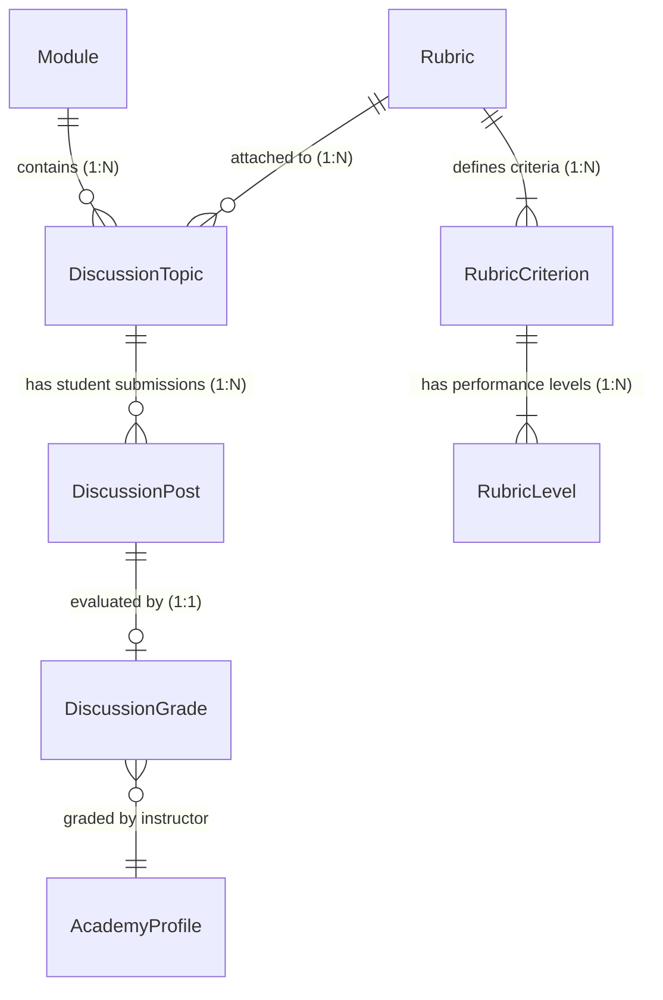
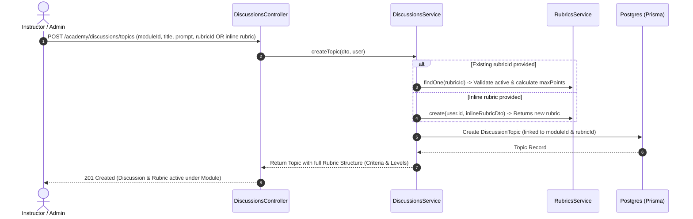
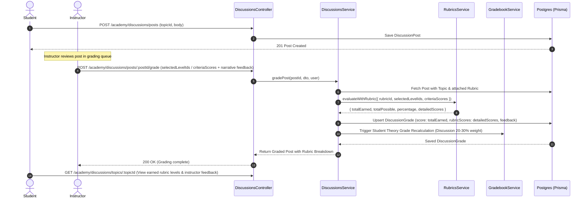

# Implementation Plan: Module Discussion Rubrics & Student Evaluation Engine

This document outlines the technical design, data architecture, and step-by-step engineering plan to associate **Rubrics** under **Module Discussions** and perform **Rubric-Based Student Grading** within `apps/academy-service`.

---

## 1. System Architecture & Relational Model



### Key Entities & Relations
* **`Module`:** The container for course content (`THEORY_ASYNC`).
* **`DiscussionTopic`:** Represents a required unit discussion under a module with a prompt, due dates, max points, and a reference to an active `Rubric`.
* **`Rubric` & `RubricCriterion` & `RubricLevel`:** Standardized multi-tier evaluation rubrics (e.g., *Outcome Mastery*, *Critical Thinking*, *Professional Engagement*).
* **`DiscussionPost`:** Student posts and replies submitted within a topic.
* **`DiscussionGrade`:** The grade record containing the total calculated score, JSON breakdown of points per criterion (`rubricScores`), and individualized instructor feedback.

---

## 2. Operational Workflows

### 2.1 Discussion Topic Creation with Module Rubric
An instructor creates a discussion under a specific course module, choosing either an existing rubric or defining a new one inline.



---

### 2.2 Student Discussion Submission & Rubric-Based Grading
A student submits their post. The instructor evaluates the submission by selecting criteria levels, adding qualitative feedback, and generating a grade that immediately syncs to the gradebook.



---

## 3. Step-by-Step Implementation Roadmap

### Step 1: Database Schema Migration
**Target File:** [`apps/academy-service/prisma/schema.prisma`](file:///c:/Users/X1/pro/1_Active/alikohub/Aliko_backend/apps/academy-service/prisma/schema.prisma)

Enhance `DiscussionTopic` to establish a formal foreign key and relation to `Rubric`:

```prisma
model DiscussionTopic {
  id          Int               @id @default(autoincrement())
  moduleId    Int
  title       String
  prompt      String
  rubricId    String?           // Foreign key to Rubric table
  rubric      Json?             // Fallback snapshot / legacy support
  maxPoints   Float             @default(10)
  dueDate     DateTime?
  createdAt   DateTime          @default(now())

  module      Module            @relation(fields: [moduleId], references: [id], onDelete: Cascade)
  rubricRef   Rubric?           @relation(fields: [rubricId], references: [id], onDelete: SetNull)
  posts       DiscussionPost[]
}
```

**Commands:**
```powershell
npx prisma format --schema=apps/academy-service/prisma/schema.prisma
npx prisma generate --schema=apps/academy-service/prisma/schema.prisma
```

---

### Step 2: DTO & Validation Specifications

#### 2.1 Update Discussion Topic Creation DTO
**File:** [`apps/academy-service/src/discussions/dto/create-topic.dto.ts`](file:///c:/Users/X1/pro/1_Active/alikohub/Aliko_backend/apps/academy-service/src/discussions/dto/create-topic.dto.ts)

```typescript
import { IsDateString, IsInt, IsNumber, IsOptional, IsString, ValidateNested } from 'class-validator';
import { Type } from 'class-transformer';
import { CreateRubricDto } from '../../rubrics/dto';

export class CreateDiscussionTopicDto {
  @IsInt()
  moduleId: number;

  @IsString()
  title: string;

  @IsString()
  prompt: string;

  @IsOptional()
  @IsString()
  rubricId?: string;

  @IsOptional()
  @ValidateNested()
  @Type(() => CreateRubricDto)
  rubric?: CreateRubricDto;

  @IsOptional()
  @IsNumber()
  maxPoints?: number;

  @IsOptional()
  @IsDateString()
  dueDate?: string;
}
```

#### 2.2 Update Discussion Post Grading DTO
**File:** [`apps/academy-service/src/discussions/dto/grade-post.dto.ts`](file:///c:/Users/X1/pro/1_Active/alikohub/Aliko_backend/apps/academy-service/src/discussions/dto/grade-post.dto.ts)

```typescript
import { IsArray, IsBoolean, IsNumber, IsOptional, IsString } from 'class-validator';

export class CriterionScoreInput {
  criterionId: string;
  levelId?: string;
  points: number;
  feedback?: string;
}

export class GradeDiscussionPostDto {
  @IsOptional()
  @IsNumber()
  score?: number;

  @IsOptional()
  @IsNumber()
  grade?: number;

  @IsOptional()
  @IsString()
  rubricId?: string;

  @IsOptional()
  @IsArray()
  selectedLevelIds?: string[];

  @IsOptional()
  @IsArray()
  criteriaScores?: CriterionScoreInput[];

  @IsString()
  feedback: string; // Required for WAC Req 15 (Individualized non-automated feedback)

  @IsOptional()
  @IsBoolean()
  isSubstantive?: boolean;
}
```

#### 2.3 Update Joi Validation Schemas
**File:** [`apps/academy-service/src/discussions/discussions.validation.ts`](file:///c:/Users/X1/pro/1_Active/alikohub/Aliko_backend/apps/academy-service/src/discussions/discussions.validation.ts)

Ensure validation accepts either manual `score`/`grade` OR rubric-driven inputs (`selectedLevelIds`/`criteriaScores`):
```typescript
const gradePostDtoSchema = Joi.object({
  score: Joi.number().min(0).optional(),
  grade: Joi.number().min(0).optional(),
  rubricId: Joi.string().uuid().optional(),
  selectedLevelIds: Joi.array().items(Joi.string()).optional(),
  criteriaScores: Joi.array().items(
    Joi.object({
      criterionId: Joi.string().required(),
      levelId: Joi.string().optional(),
      points: Joi.number().min(0).required(),
      feedback: Joi.string().optional(),
    })
  ).optional(),
  feedback: Joi.string().required().min(5),
  rubricScores: Joi.any().optional(),
  isSubstantive: Joi.boolean().optional(),
}).or('score', 'grade', 'selectedLevelIds', 'criteriaScores');
```

---

### Step 3: Service Layer Integration

#### 3.1 Module Dependency Configuration
**File:** [`apps/academy-service/src/discussions/discussions.module.ts`](file:///c:/Users/X1/pro/1_Active/alikohub/Aliko_backend/apps/academy-service/src/discussions/discussions.module.ts)

Import `RubricsModule`:
```typescript
import { Module } from '@nestjs/common';
import { DiscussionsController } from './discussions.controller';
import { DiscussionsService } from './discussions.service';
import { PrismaModule } from '../prisma/prisma.module';
import { UserModule } from '../user/user.module';
import { RubricsModule } from '../rubrics/rubrics.module';

@Module({
  imports: [PrismaModule, UserModule, RubricsModule],
  controllers: [DiscussionsController],
  providers: [DiscussionsService],
  exports: [DiscussionsService],
})
export class DiscussionsModule {}
```

#### 3.2 Update `createTopic` in `DiscussionsService`
**File:** [`apps/academy-service/src/discussions/discussions.service.ts`](file:///c:/Users/X1/pro/1_Active/alikohub/Aliko_backend/apps/academy-service/src/discussions/discussions.service.ts)

Inject `RubricsService` and resolve the rubric during topic initialization:
```typescript
// 1. Resolve Rubric ID & Points
let resolvedRubricId: string | null = dto.rubricId || null;
let calculatedMaxPoints = dto.maxPoints ?? 10;

if (dto.rubricId) {
  const existingRubric = await this.rubricsService.findOne(dto.rubricId);
  if (existingRubric && existingRubric.criteria) {
    calculatedMaxPoints = existingRubric.criteria.reduce((acc, c) => acc + c.maxPoints, 0);
  }
} else if (dto.rubric && typeof dto.rubric === 'object') {
  const createdRubric = await this.rubricsService.create(user.firebaseId, {
    ...dto.rubric,
    type: 'DISCUSSION',
  });
  resolvedRubricId = createdRubric.id;
  calculatedMaxPoints = (createdRubric.criteria || []).reduce((acc, c) => acc + c.maxPoints, 0);
}

// 2. Persist DiscussionTopic
const topic = await this.prisma.discussionTopic.create({
  data: {
    moduleId: dto.moduleId,
    title: dto.title,
    prompt: dto.prompt,
    rubricId: resolvedRubricId,
    rubric: dto.rubric ?? undefined,
    maxPoints: calculatedMaxPoints,
    dueDate: dto.dueDate ? new Date(dto.dueDate) : null,
  },
  include: {
    rubricRef: {
      include: {
        criteria: {
          orderBy: { order: 'asc' },
          include: { levels: { orderBy: { order: 'asc' } } },
        },
      },
    },
  },
});
```

#### 3.3 Hydrate Rubric when Reading Discussions
In `findAllByModule` and `getTopicWithPosts`, include `rubricRef`:
```typescript
include: {
  rubricRef: {
    include: {
      criteria: {
        orderBy: { order: 'asc' },
        include: { levels: { orderBy: { order: 'asc' } } },
      },
    },
  },
  // ... other relations
}
```

#### 3.4 Upgrade `gradePost` to Execute Rubric Evaluation
In `DiscussionsService.gradePost`:
```typescript
async gradePost(postId: number, dto: GradeDiscussionPostDto, user: AuthenticatedUser) {
  // Authorization check (Instructor or Admin)
  const post = await this.prisma.discussionPost.findUnique({
    where: { id: postId },
    include: {
      topic: {
        include: {
          module: { include: { course: true } },
          rubricRef: true,
        },
      },
    },
  });
  if (!post) throw new NotFoundException('Discussion post not found');

  let finalScore = dto.score ?? dto.grade ?? 0;
  let rubricBreakdown: any = dto.rubricScores || null;

  // Execute Rubric Evaluation if rubric selection submitted
  const targetRubricId = dto.rubricId || post.topic.rubricId;
  if (targetRubricId && (dto.selectedLevelIds?.length || dto.criteriaScores?.length)) {
    const evaluation = await this.rubricsService.evaluateWithRubric({
      rubricId: targetRubricId,
      selectedLevelIds: dto.selectedLevelIds,
      criteriaScores: dto.criteriaScores,
      customFeedback: dto.feedback,
    });
    finalScore = evaluation.totalEarned;
    rubricBreakdown = evaluation.detailedScores;
  }

  // Persist Grade
  const grade = await this.prisma.discussionGrade.upsert({
    where: { postId },
    update: {
      score: finalScore,
      rubricScores: rubricBreakdown,
      feedback: dto.feedback,
      graderId: user.firebaseId,
    },
    create: {
      postId,
      score: finalScore,
      rubricScores: rubricBreakdown,
      feedback: dto.feedback,
      graderId: user.firebaseId,
    },
  });

  return grade;
}
```

---

## 4. Gradebook Integration & Regulatory Compliance

* **Automatic Recalculation:** `GradebookService.getStudentGradebook` computes theory score using:
  $$\text{Discussion \%} = \frac{\sum (\text{DiscussionGrade.score} / \text{DiscussionTopic.maxPoints})}{\text{Count of Graded Discussions}} \times 100$$
* **WAC 246-841A-440 Alignment:**
  * **Requirement 13:** Every unit module contains a discussion topic equipped with an analytical rubric.
  * **Requirement 15:** Enforces non-empty instructor narrative comments (`feedback.length >= 5`) alongside rubric level selections, ensuring human, non-automated evaluation.

---

## 5. Verification & Test Plan

1. **Rubric Creation Test:** Create a standardized 3-criteria discussion rubric (Outcome Mastery [4 pts], Critical Thinking [3 pts], Peer Engagement [3 pts]).
2. **Topic Creation Test:** Create a discussion topic under Module 1 specifying the `rubricId`. Verify response includes hydrated criteria and performance levels.
3. **Student Post Test:** Post student reply via `POST /academy/discussions/posts`.
4. **Rubric Grading Test:**
   * Submit `POST /academy/discussions/posts/:postId/grade` with `selectedLevelIds` and personalized feedback.
   * Verify calculated score matches level sums (e.g., 4 + 3 + 2 = 9).
   * Verify `rubricScores` captures criterion-level breakdown.
5. **Gradebook Audit:** Request `GET /academy/gradebook/student/:userId` and verify that the discussion grade contributes accurately to the student's 20% theory discussion weight.
